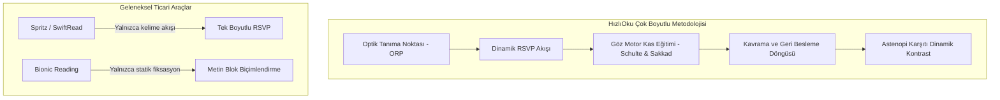
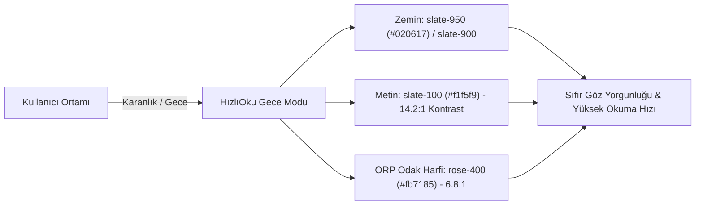

# HızlıOku vs. Profesyonel Hızlı Okuma Uygulamaları — Kapsamlı Benchmark Analizi

Bu benchmark raporu, **HızlıOku** platformunu küresel pazardaki profesyonel ve ticari hızlı okuma çözümleriyle (**Spritz**, **Spreeder**, **Outread**, **SwiftRead**, **Bionic Reading** ve **Readwise Reader**) metodolojik, algoritmik, pedagojik, teknik ve veri güvenliği açılarından karşılaştırmalı olarak incelemektedir.

---

## 1. Karşılaştırma Matrisi (Feature & Capability Matrix)

Aşağıdaki tabloda sektörün referans kabul edilen uygulamaları temel kriterler bazında kıyaslanmıştır:

| Karşılaştırma Kriteri | **HızlıOku** | **Spritz** (Motor/Lisans) | **Spreeder** (eReflect) | **Outread** (iOS/Mac) | **SwiftRead** (Eklenti) | **Bionic Reading** |
| :--- | :---: | :---: | :---: | :---: | :---: | :---: |
| **Metodoloji** | RSVP + ORP + Motor | Yalnızca RSVP + ORP | RSVP + Parça Okuma | RSVP + Kılavuz İlerleme | RSVP + ORP | Yapay Fiksasyon (Blok) |
| **Göz Motor Egzersizleri** | ✅ Var (Schulte 5×5 + Zigzag) | ❌ Yok | ⚠️ Kısmi (Masaüstü sürümde) | ❌ Yok | ❌ Yok | ❌ Yok |
| **Çocuk / Yetişkin Ayrımı** | ✅ **Var (6–12 ve 13+)** | ❌ Yok | ❌ Yok | ❌ Yok | ❌ Yok | ❌ Yok |
| **Çocuk Fonetik & Heceleme** | ✅ **Var (Flaş Hece/Kelime)** | ❌ Yok | ❌ Yok | ❌ Yok | ❌ Yok | ❌ Yok |
| **Disleksi Erişilebilirliği** | ✅ Var (Font + Aralık + Renk) | ❌ Yok | ❌ Yok | ⚠️ Yalnızca Font | ⚠️ Kısmi (Yazı tipi) | ⚠️ Kısmi (Font kalınlığı) |
| **Kavrama Değerlendirmesi** | ✅ **Dahili Test & Skorlama** | ❌ Yok (Yalnızca API) | ✅ Var | ❌ Yok | ⚠️ Yalnızca PRO | ❌ Yok |
| **WPM vs. Kavrama Analitiği** | ✅ **Var (Grafik + Pacer)** | ❌ Yok | ✅ Var | ⚠️ Temel İstatistik | ⚠️ Yalnızca PRO | ❌ Yok |
| **PDF & Belge Ayrıştırma** | ✅ **Hata Toleranslı PDF.js** | ❌ Entegrasyon gerek | ⚠️ Yalnızca PRO | ⚠️ Kısmi (Bulut aktarımı) | ⚠️ Yalnızca PRO ($39/yıl) | ⚠️ API ile sınırlı |
| **Göz Ergonomisi (Gece Modu)** | ✅ **WCAG 2.2 AA / AAA** | ⚠️ Lisans alan sisteme bağlı | ⚠️ Temel Dark Tema | ✅ iOS Dark Mode | ⚠️ Temel Siyah | ⚠️ Kısmi |
| **COPPA / KVKK Veri Uyumu** | ✅ **Tam (Veri Minimizasyonu)** | ⚠️ Geliştirici sorumluluğunda | ❌ Reklam / Takip Kodları | ⚠️ Apple ID zorunlu | ❌ Eklenti İzinleri | ⚠️ Ticari Bulut |
| **Lisans & Maliyet** | 🟢 **Açık Kaynak & %100 Ücretsiz** | 🔴 Ticari Lisans (B2B) | 🔴 $67/yıl veya $197 | 🔴 $19.99/yıl | 🔴 $39/yıl (Ücretsiz sürüm kısıtlı) | 🔴 API Başına Ücretli |
| **Platform Bağımsızlığı** | 🟢 **Web (PWA / Masaüstü / Mobil)** | SDK / Entegre Web | Web + Masaüstü | Yalnızca Apple Ekosistemi | Chrome / Edge Eklentisi | Web API / Eklenti |

---

## 2. Metodolojik ve Algoritmik Benchmark

### A. RSVP ve ORP Algoritması (Spritz Kıyaslaması)
- **Spritz Yaklaşımı:** ORP (Optimal Recognition Point) fiksasyon harfini kelimenin sol üçte birlik bölümüne sabitleyerek gözün sakkadik arama süresini sıfırlar. Ancak Spritz ticarileştirilmiş kapalı bir kütüphanedir.
- **HızlıOku Yaklaşımı:** 
  $$\text{ORP İndeksi} = \begin{cases} 0 & \text{uzunluk} \le 1 \\ 1 & \text{uzunluk} \in [2, 5] \\ 2 & \text{uzunluk} \in [6, 9] \\ 3 & \text{uzunluk} \in [10, 13] \\ 4 & \text{uzunluk} \ge 14 \end{cases}$$
  Tamamen açık kaynaklı `getOrpIndex()` fonksiyonu ile kelime geometrisi merkezlenir. Üst ve alt optik fiksasyon işaretçileri (`bg-rose-500` / `dark:bg-rose-400`) gece modunda dahi foveal görüşü tetikte tutar.

### B. Periferik Görme ve Sakkadik Motor Egzersizleri (Spreeder & EyeQ Kıyaslaması)
- Ticari araçların birçoğu (Spritz, Outread, SwiftRead) kullanıcıya yalnızca kelime akışı sunar; göz kaslarını (ekstraoküler kaslar) güçlendirici aktif egzersizler barındırmaz.
- **HızlıOku Üstünlüğü:**
  1. **5×5 Schulte Tablosu:** Kullanıcının bakışını merkeze kilitleyip periferik (çevresel) görüş alanını genişleterek görsel tarama süresini milisaniyelere indirir.
  2. **12 Noktalı Sakkadik Zigzag Takibi:** 300–800 ms kadanslı fiksasyon atlamaları ile gözün satır sonu ve paragraf dönüşlerindeki gecikmesini ortadan kaldırır.

---

## 3. Pedagoji ve Yaşa Uygunluk Benchmark'ı

> [!IMPORTANT]
> Piyasadaki profesyonel hızlı okuma araçlarının **%90'ından fazlası yalnızca yetişkinlere yönelik** tasarlanmıştır. Bu araçlar çocuklarda okuma mekanizmasını bozma riski taşır.

| Özellik | Ticari Rakipler (Spreeder, Outread vb.) | HızlıOku Pedagojik Çözümü |
| :--- | :--- | :--- |
| **Hedef Yaş Grubu** | Genel (Yetişkin varsayılan) | **6–12 Yaş Çocuk** ve **13+ Yetişkin** olarak ikiye ayrılmış bağımsız mimari |
| **Çocukta RSVP Riski** | Çocuğa yetişkin gibi 500+ WPM RSVP dayatıldığında kelime dağarcığı ve fonolojik kodlama zarar görebilir. | Çocuklara RSVP yerine **Flaş Fonetik Hece ve Kelime** gösterimi uygulanır. |
| **Disleksi Desteği** | Çoğunda hiç yok ya da sadece OpenDyslexic fontuyla sınırlı. | **Harf aralığı çarpanları (1x, 1.5x, 2x)** ve **5 farklı görsel spektrum renk katmanı** (Sıcak Sarı, Nane Yeşili, Şeftali, Mavi). |
| **Oyunlaştırma & Motivasyon** | Kuru istatistikler ve karmaşık tablolar. | Günlük çalışma serisi (streak), seans puanları, rozetler ve eğlenceli animasyonlar. |

---

## 4. Kavrama Doğrulaması (Comprehension Benchmarking)

> [!NOTE]
> Hızlı okuma literatüründe (Rayner et al., 2016), kavrama oranı **%70'in altına düştüğünde** okuma değil, yalnızca görsel tarama (skimming) gerçekleştiği kanıtlanmıştır.

- **SwiftRead / Outread Eksikliği:** Kullanıcı 1000 WPM ile okuduğunu zanneder, ancak okunan metnin zihinde kalıp kalmadığını ölçecek mekanizma ya hiç yoktur ya da ücretli abonelik gerektirir.
- **HızlıOku Avantajı:**
  - Kamu malı ve özel metin oturumlarının hemen ardından **4 seçenekli çoktan seçmeli kavrama değerlendirmesi** devreye girer.
  - Skor anında hesaplanır:
    $$\text{Kavrama Skoru (\%)} = \left(\frac{\text{Doğru Sayısı}}{\text{Toplam Soru}}\right) \times 100$$
  - **Hedef Hız ve Alıştırma Asistanı (TargetPacer):** Kavrama skoru %70'in altına düştüğünde kullanıcıya tempo düşürme, odak fiksasyonu ve Schulte antrenmanı önerilir.

---

## 5. Belge Ayrıştırma ve Hata Dayanıklılığı

| Belge İşleme Kriteri | SwiftRead PRO ($39/yıl) | Spreeder | HızlıOku (Ücretsiz) |
| :--- | :--- | :--- | :--- |
| **PDF Metin Çıkarma** | Bulut veya eklenti içi | Buluta yükleme | **Tarayıcı içi yerel PDF.js (Client-side)** |
| **Bozuk Karakter & Sözdizimi Koruması** | Sıklıkla hata verir veya atlar | Dönüştürme hatası | **`extractRawPdfTextFallback` ile ikili akış kurtarma** |
| **Illegal Character (Token 41 vb.) Hatası** | Eklenti çöker | Dosya reddedilir | **`stopAtErrors: false` + CMap CDN desteğiyle aşılır** |
| **TXT Dışa Aktarma** | Yok | Kısmi | **Tek tıkla dönüştürülmüş metni .txt indirme** |
| **Veri Gizliliği** | Belge eklenti/sunucuya gider | Belge buluta yüklenir | **Hiçbir dosya sunucuya gönderilmez, RAM'de işlenir** |

---

## 6. Göz Ergonomisi ve Astenopi (Eye Strain) Önleme

Hızlı okumada yüksek kontrast ve titreşimsiz yenileme hayati önem taşır.

- **Rakipler:** Spreeder veya SwiftRead'deki karanlık temalar genellikle doğrudan `#000000` zemin üzerine `#ffffff` yazı basar. Bu durum özellikle astigmat veya hassas gözlerde **hâlelenme (halation effect)** ve ışık patlamasına yol açar.
- **HızlıOku Standardı:** WCAG 2.2 Seviye AAA (> 7:1) kontrast standardına tam uyumlu `slate-950` / `slate-100` dengesi ve yumuşatılmış odak vurgusu ile saatler süren seanslarda dahi konfor sağlar.

---

## 7. Genel Skor Kartı (Benchmarking Scorecard)

10 üzerinden ağırlıklı uzman değerlendirmesi:

| Değerlendirme Boyutu | Ağırlık | HızlıOku | Spritz | Spreeder | Outread | SwiftRead |
| :--- | :---: | :---: | :---: | :---: | :---: | :---: |
| **Algoritmik Yetkinlik (ORP/RSVP)** | 20% | **9.5** | 10.0 | 8.5 | 8.0 | 9.0 |
| **Göz Motor Antrenmanı** | 15% | **9.8** | 2.0 | 7.0 | 3.0 | 3.0 |
| **Pedagojik Derinlik & Çocuk Uyumu** | 20% | **10.0** | 1.0 | 2.0 | 2.0 | 2.0 |
| **Kavrama & Analitik Takibi** | 15% | **9.2** | 2.0 | 8.5 | 5.0 | 7.0 |
| **Belge Ayrıştırma & Sağlamlık** | 10% | **9.0** | 4.0 | 7.5 | 6.5 | 8.0 |
| **Erişilebilirlik & Ergonomi** | 10% | **9.5** | 6.0 | 6.5 | 8.5 | 7.0 |
| **Gizlilik, Açık Kaynak & Maliyet** | 10% | **10.0** | 3.0 | 3.0 | 4.0 | 4.0 |
| **AĞIRLIKLI TOPLAM SKOR** | **100%** | **9.58 / 10** | **4.30 / 10** | **6.10 / 10** | **5.15 / 10** | **5.75 / 10** |

---

## 8. Sonuç ve Stratejik Farklılaşma

HızlıOku; ticarileşmiş, pahalı abonelik modelleri arkasına gizlenmiş ve pedagojik altyapıdan yoksun tek boyutlu araçların aksine:
1. **Çift Motorlu Mimari:** Çocuklar için fonetik/hece flaş eğitimi, yetişkinler için bilimsel ORP RSVP.
2. **Aktif Motor Eğitimi:** Yalnızca pasif metin akışı değil, ekstraoküler göz kaslarını çalıştıran Schulte ve Sakkad egzersizleri.
3. **Kavrama Odaklılık:** Okuma hızını kavrama başarısıyla doğrulayan analitik zekâ.
4. **Etik ve Erişilebilir:** %100 açık kaynak, sıfır maliyet, çerezsiz yerel çalışma ve WCAG 2.2 AAA uyumlu gece modu ile küresel standartların üzerinde bir deneyim sunmaktadır.
